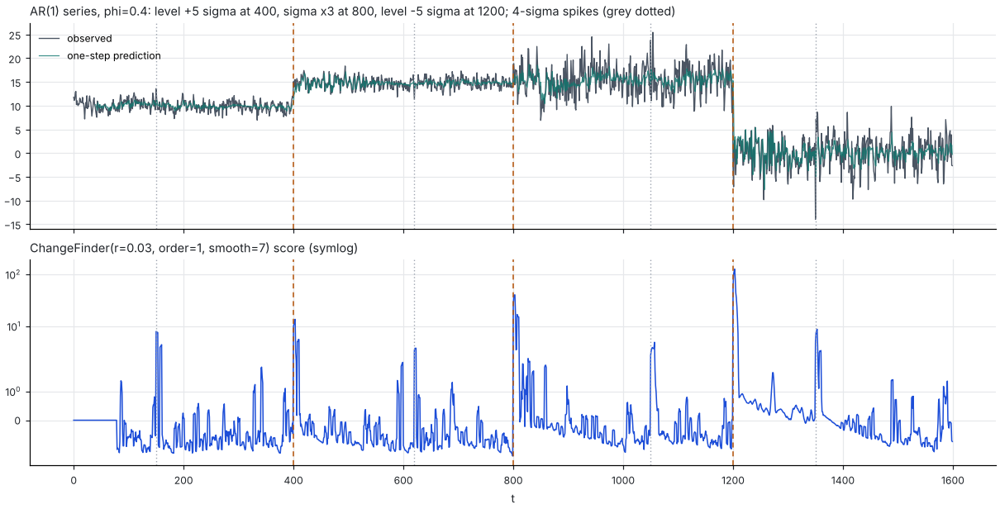
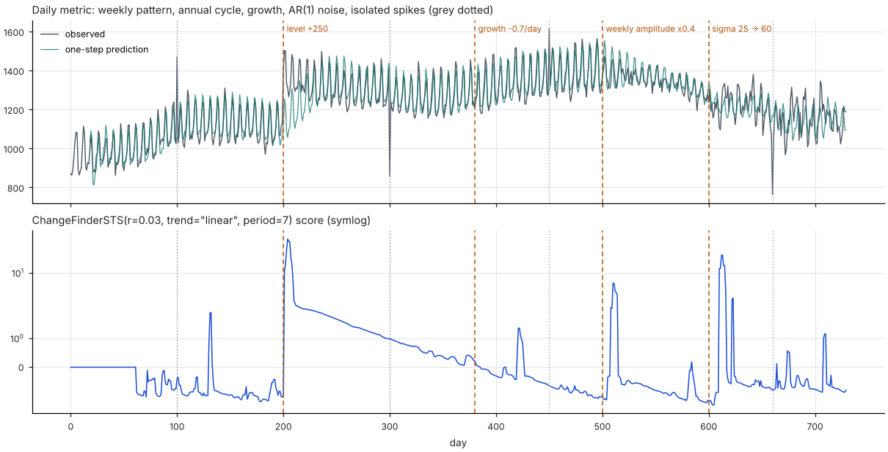

changefinder
============

.. image:: https://img.shields.io/pypi/v/changefinder.svg
   :target: https://pypi.org/project/changefinder/
   :alt: PyPI

.. image:: https://img.shields.io/badge/license-MIT-blue.svg
   :target: https://github.com/shunsukeaihara/changefinder/blob/main/LICENSE.txt
   :alt: MIT License

Online change-point detection for univariate time series, based on the
ChangeFinder algorithm of Yamanishi & Takeuchi, with models for series that
have trend and seasonality.

Every detector consumes one observation at a time, keeps a fixed amount of
state, and returns a change-point score for that observation together with
the one-step-ahead prediction. Nothing is recomputed on past data, so the
cost per observation is constant.

How it works
------------

ChangeFinder runs two stages of the same idea:

1. **Outlier score.** An online model predicts ``x_t`` from the past and
   scores it with the negative log-likelihood of that prediction,
   ``-log p(x_t | x_1 .. x_{t-1})``. A surprising observation gets a high
   score, whether it is a one-off outlier or the first point of a new regime.
2. **Change-point score.** The outlier scores are smoothed over ``smooth``
   steps and the smoothed series is scored again by a second online model.
   A single outlier is diluted by the smoothing; a change of regime keeps
   the smoothed score high for a while and is picked up by the second stage.

The library provides several first-stage models. The original uses the
SDAR model (sequentially discounting AR), which learns an AR(``order``)
process with a forgetting factor ``r``. The others handle trend and
seasonality, which the plain AR model treats as changes.

Install
-------

::

    pip install changefinder

Requires Python 3.8 or later, numpy, scipy and statsmodels.

Quick start
-----------

.. code-block:: python

    import changefinder

    cf = changefinder.ChangeFinder(r=0.05, order=1, smooth=7)
    for x in data:
        score, predict = cf.update(x)

``score`` is the change-point score of ``x`` (larger means a more likely
change; it is 0.0 while the detector warms up) and ``predict`` is the
one-step-ahead prediction of ``x`` before ``x`` was seen.

To score an observation without learning it, for example to evaluate the
same value twice or to ask "what if", pass ``inplace=False``:

.. code-block:: python

    score, predict = cf.update(x, inplace=False)   # state unchanged

Piecewise-stationary series
---------------------------

The setting of the original ChangeFinder papers: a stationary process whose
mean or variance changes abruptly, with a few isolated outliers mixed in.
Here an AR(1) process gets a level shift, a change of the noise level and a
second level shift, plus four spikes:

.. code-block:: python

    cf = changefinder.ChangeFinder(r=0.03, order=1, smooth=7)
    for x in data:
        score, predict = cf.update(x)

Each regime change produces a sharp peak three steps after it happens (the
lag of the smoothing windows). The spikes score lower than the changes
because the smoothing dilutes a single surprising observation, but they
are not invisible: with ``r=0.03`` a 4-sigma spike reaches a score of
about 5 to 9 against change-point peaks of 14 to 130. The series after the
third change also shows the score settling back as the model adapts to the
new regime.

Series with trend and seasonality
---------------------------------

A daily business metric with a weekly pattern, slow growth, autocorrelated
noise and a few isolated spikes, scored by ``ChangeFinderSTS``:

.. code-block:: python

    cf = changefinder.ChangeFinderSTS(r=0.03, trend="linear", period=7)
    for x in data:
        score, predict = cf.update(x)

The level shift, the change of the weekly amplitude and the change of the
noise level are reported with a lag of a few days, while the four isolated
spikes are not. The change of the growth rate at day 380 is not detected;
see `Limitations`_.

Detectors
---------

All detectors share ``update(x, inplace=True) -> (score, predict)`` and the
two-stage structure above; they differ in the first-stage model.

.. list-table::
   :header-rows: 1
   :widths: 22 40 38

   * - Class
     - First-stage model
     - Use it for
   * - ``ChangeFinder``
     - SDAR, an AR(``order``) model with forgetting factor ``r``
     - Stationary series; the original algorithm.
   * - ``ChangeFinderSI``
     - SDAR on the differenced input (``d`` regular and ``D`` seasonal
       differences with ``period``), predictions mapped back to the
       original scale
     - A cheap way to remove a trend and a stable seasonal pattern. Level
       shifts become single spikes in the differenced series, so they are
       harder to tell from outliers.
   * - ``ChangeFinderSTL``
     - SDAR on the one-step-ahead residual of an online seasonal-trend
       decomposition (OnlineSTL, ``periods``, ``gamma``)
     - Long or multiple seasonal periods (hourly data with daily and
       weekly cycles). Needs ``4 * max(periods)`` points to initialize.
   * - ``ChangeFinderSTS``
     - Structural time series model (level, optional linear trend,
       Fourier seasonality) estimated with a discount Kalman filter; the
       score uses the full predictive distribution
     - Real data with trend and seasonality. Recommended default for
       daily or weekly business and operations metrics.
   * - ``ChangeFinderARIMA``
     - A (seasonal) ARIMA model refitted on the last ``term`` points at
       every step (``order``, ``seasonal_order``, ``trend``)
     - When an explicit SARIMA specification is wanted. Slow: one
       maximum-likelihood fit per observation and stage.

Parameters
----------

Common to all detectors:

``smooth``
    Smoothing window ``T`` of the first-stage scores (default 7). The
    second smoothing uses ``round(T / 2)``. A change is reported with a lag
    of a few steps because of these windows.
``smoothing``
    ``"mean"`` (the original) or ``"median"``. The median passes sustained
    changes but not isolated spikes, which keeps outliers out of the
    change-point score; it is the default for ``ChangeFinderSTS``.
``clip``
    Residuals beyond ``clip`` predictive standard deviations are winsorized
    in the learning step (default 3.0; the score itself is never clipped).
    Without it one outlier inflates the variance estimate and hides the
    changes of the next ``1 / r`` steps. ``None`` disables it.

SDAR based detectors (``ChangeFinder``, ``ChangeFinderSI``, ``ChangeFinderSTL``):

``r``
    Forgetting factor in (0, 1). About ``1 / r`` observations are effective,
    so ``r=0.05`` remembers roughly the last 20 points and ``r=0.01`` the
    last 100. Smaller ``r`` gives steadier estimates and slower adaptation.
``order``
    AR order. Use 1, at most 2, on real data: with only ``1 / r`` effective
    observations higher orders overfit, underestimate the residual variance
    and raise the false-alarm level.

``ChangeFinderSTS``:

``trend``
    ``"level"`` (local level) or ``"linear"`` (level and slope). Use
    ``"linear"`` for metrics that grow or decline.
``period``, ``harmonics``
    Seasonal period and the number of Fourier harmonics (default
    ``period // 2``, equivalent to one state per season; fewer harmonics
    give a smoother pattern and fewer states).
``discount``
    How fast the state components may drift, in (0, 1]; default 0.95.
    A dict such as ``{"level": 0.95, "slope": 0.99, "seasonal": 0.99}``
    sets them per component. Closer to 1 is stiffer.
``r``
    Forgetting factor of the observation-noise variance and of the
    second-stage SDAR.

``ChangeFinderSTL``:

``periods``
    One period or a list of periods (any order).
``gamma``
    Smoothing factor of the seasonal estimates (paper default 0.7). Values
    around 0.3 give steadier seasonal patterns and cleaner residuals.

The decomposition itself is available as ``changefinder.OnlineSTL`` with
``initialize(series)``, ``update(x) -> (trend, seasonal, residual)`` and
``forecast()``.

Warm-up
-------

Scores are 0.0 until the detector has seen enough data:

* SDAR learns the first ``ceil(1 / r)`` observations with plain averages
  before scoring, and both stages do so.
* ``ChangeFinderSTS`` fits its initial state by least squares on the first
  ``max(10, 2 * period, 2 * states + 2)`` observations.
* ``ChangeFinderSTL`` initializes the decomposition on the first
  ``4 * max(periods)`` observations.
* ``ChangeFinderARIMA`` needs ``term`` observations per stage.

Limitations
-----------

* **Changes of the growth rate** (a kink in the trend) are not detected
  unless the slope changes by about one noise standard deviation per step.
  Their evidence accumulates over many steps while these detectors score
  one step at a time, and the slope state of ``ChangeFinderSTS`` simply
  follows the new growth. Use a window-based slope test or a CUSUM for that.
* A change of the AR dynamics alone (same mean and variance) is a weak
  signal for the one-step-ahead model.
* Scores are log-likelihood ratios, not probabilities: their scale depends
  on the model and the data, so thresholds have to be calibrated on a
  stationary stretch of the series.
* The ARIMA detector swallows a failed fit (returning a zero score) after
  warning once; make ``term`` several times the seasonal period.

Development
-----------

::

    pip install .[test]
    pytest

``test/synthetic.py`` contains the generators used by the tests and in the
figures above: ``generate_series`` (the piecewise-stationary AR(1) series)
and ``generate_daily_series`` (the daily metric).

References
----------

* K. Yamanishi and J. Takeuchi. A unifying framework for detecting outliers
  and change points from non-stationary time series data. KDD 2002.
* J. Takeuchi and K. Yamanishi. A unifying framework for detecting outliers
  and change points from time series. IEEE TKDE 18(4), 2006.
* A. Mishra, R. Sriharsha and S. Zhong. OnlineSTL: Scaling time series
  decomposition by 100x. PVLDB 15(7), 2022.
* M. West and J. Harrison. Bayesian Forecasting and Dynamic Models,
  2nd ed. Springer, 1997 (discount Kalman filters).

Changelog
---------

0.5
    ``ChangeFinderSI``, ``ChangeFinderSTL`` (with ``OnlineSTL``) and
    ``ChangeFinderSTS``; seasonal and trend options for
    ``ChangeFinderARIMA``; ``clip`` and ``smoothing`` options; SDAR warm
    start without a burn-in spike.
0.4
    Deterministic SDAR with the paper's scoring order, numerically stable
    scores, ``ChangeFinderARIMA`` ported to the current statsmodels API,
    ``update(x, inplace=False)``, pytest suite, pyproject packaging.

Authors
-------

* Shunsuke Aihara - http://argmax.jp

License
-------

MIT License.
